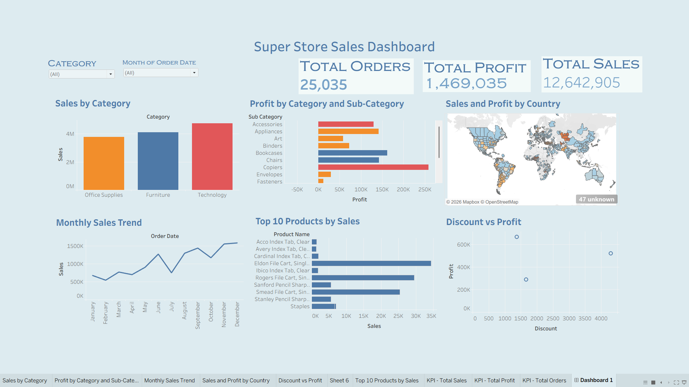

# 📊 Super Store Sales Dashboard | Tableau

## 📌 Project Overview

This project focuses on analyzing Super Store sales data using Tableau. The interactive dashboard provides insights into sales, profit, orders, product performance, category-wise sales, and monthly sales trends.

The objective is to transform raw sales data into meaningful visual insights that help understand business performance and support data-driven decision-making.

## 🖼️ Dashboard Preview

*Super Store Sales Dashboard created using Tableau, featuring interactive filters, KPI cards, charts, and a geographical map.*

## 🎯 Project Objectives

- Analyze total sales, total profit, and total orders.
- Compare sales across different product categories.
- Identify profitable and less profitable sub-categories.
- Analyze monthly sales trends.
- Explore sales and profit distribution geographically.
- Identify the top 10 products based on sales.
- Understand the relationship between discounts and profit.

## 🛠️ Tools & Technologies

- **Tableau** — Dashboard development and data visualization.
- **CSV Dataset** — Source data for analysis.
- **Data Analytics** — Exploratory analysis and business insights.

## 📈 Key Performance Indicators (KPIs)

| Metric | Value |
|---|---:|
| Total Orders | 25,035 |
| Total Profit | 1,469,035 |
| Total Sales | 12,642,905 |

*Note: KPI values are taken from the dashboard screenshot and may change when filters are applied.*

## 📊 Dashboard Features

### 1. Sales by Category
Compares sales across Office Supplies, Furniture, and Technology to understand category performance.

### 2. Profit by Category and Sub-Category
Analyzes profit across product sub-categories to identify profitable and less profitable product segments.

### 3. Sales and Profit by Country
Displays geographical sales and profit distribution through a map visualization.

### 4. Monthly Sales Trend
Visualizes monthly sales from January to December to identify trends and fluctuations throughout the year.

### 5. Top 10 Products by Sales
Highlights the top-performing products based on sales.

### 6. Discount vs Profit
Uses a scatter plot to explore the relationship between discount values and profit.

### 7. Interactive Filters
The dashboard includes filters for:
- Category
- Month of Order Date

These filters help users explore the dashboard based on their selected criteria.

## 📂 Project Files

| File Name | Description |
|---|---|
| `Super_Store_Dashboard.twbx` | Packaged Tableau workbook containing the dashboard |
| `SuperStoreOrders cleaning.csv` | Dataset used for the analysis |
| `Dashboard.png` | Dashboard screenshot for preview |
| `README.md` | Project documentation |

## 🚀 How to View the Project

1. Clone or download this GitHub repository.
2. Install Tableau Desktop or another compatible Tableau application.
3. Open `Super_Store_Dashboard.twbx`.
4. Explore the charts and interactive filters.
5. Use the CSV dataset for further analysis if required.

## 💡 Skills Demonstrated

- Data visualization using Tableau
- Exploratory data analysis
- KPI reporting
- Sales and profit analysis
- Product and category performance analysis
- Trend analysis
- Dashboard design and storytelling

## 📝 Conclusion

This project demonstrates how Tableau can be used to convert raw retail sales data into an interactive dashboard. It provides a clear overview of sales, profit, order volume, product performance, and monthly trends to support business analysis and data-driven decisions.

---

**Project Type:** Data Analytics  
**Domain:** Retail / Sales Analytics  
**Visualization Tool:** Tableau
